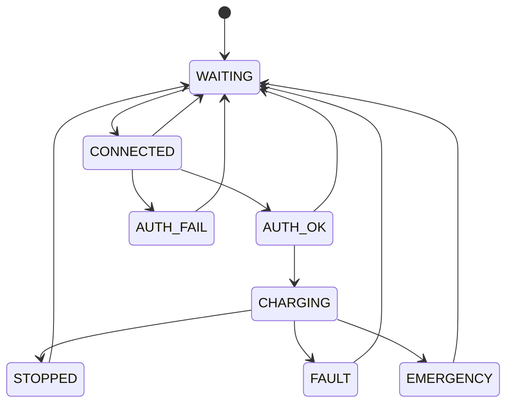

# Kripke charging model

Run `python scripts/verify_all.py --stage model` (or `make model`).
The header defines eight abstract states; `transition_hop_le` exposes the
transition relation. BFS visits all reachable states and checks label invariants.

Labels encode authentication, safe temperature/SOC, fault, emergency and zero
power. They do not contain concrete temperature values or multiple ports.
Consequently SR07/SR08/SR10 need separate implementation tests and numeric models.
P5 checks fault-zero-power (SR06), not port exclusivity.

Progress witness: three normal transitions reach CHARGING. This proves EF, not
unconditional AF or LTL liveness. Persistent requests, safe conditions, available
capacity and a fair scheduler are necessary assumptions for eventual charging.
The model deliberately abstracts recovery as return to WAITING; production has
additional READY/FULL/DISCONNECTED states.

Gateway Authentication now also has a specialized Kripke model under
`formal/gateway_auth/`. The original 8-state charging model in this directory is
kept unchanged and should not be treated as the full Gateway Auth state-space
model.
